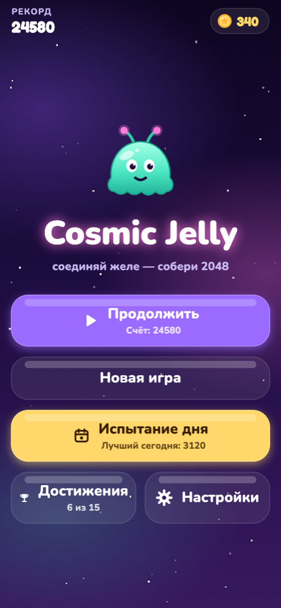
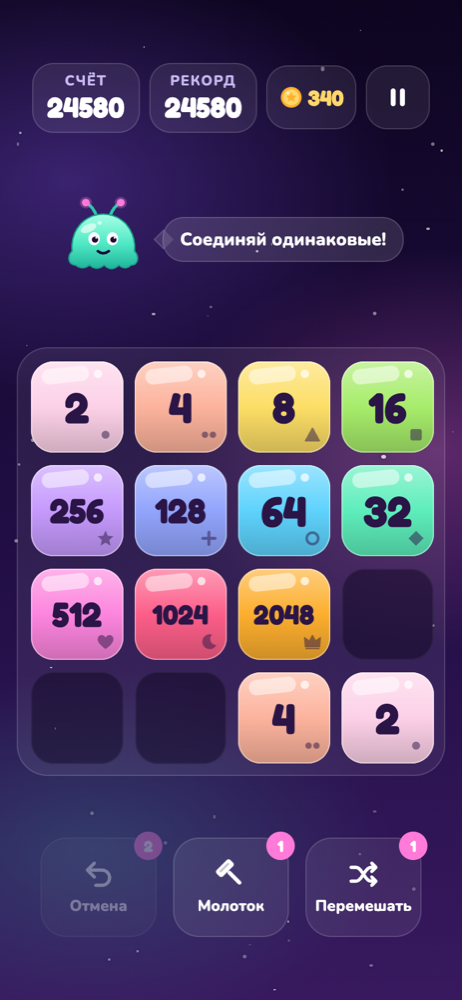
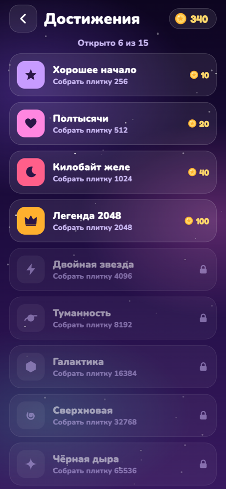

# Cosmic Jelly 🪐

### 🎮 [Play in the browser / Играть в браузере](https://tvessa4.github.io/cosmic-jelly/) · [itch.io](https://tvessa.itch.io/cosmic-jelly)

**[English](#english) · [Русский](#русский)**

<p align="center">
  
  
  
</p>

---

## English

A cozy 2048-style merge puzzle for iPhone, set in a night sky full of glowing jelly cubes.
Swipe to slide every tile, merge equal numbers and keep Glip, the little alien slime, happy.

### Features

- **Classic 2048 rules** on a 4×4 board: swipe in any direction, equal tiles merge once per move, a new 2 (90%) or 4 (10%) appears after every move that changes the board.
- **Jelly look**: translucent tiles with a gradient, highlight and soft colored glow; tiles wobble when tapped.
- **Accessible palette**: 17 distinct colors (2 … 131072) **plus a unique symbol on every tile**, so values can be told apart without relying on color. Text contrast is checked by tests.
- **Glip the mascot**: an original character with five moods: calm, happy, scared when the board is almost full, sad on game over, partying at 2048.
- **Boosters**: Undo (3 per game), Hammer (remove one tile), Shuffle.
- **Game feel**: smooth 110 ms slides, merge flashes and particles, combo labels, light screen shake, confetti, haptics of different strength.
- **Original audio**: all sound effects and the ambient music are synthesized by a script in this repo (`scripts/make-sounds.mjs`). Sound, music and haptics can each be turned off.
- **Swipe queue**: a swipe made during an animation is queued (at most one) instead of being lost.

### Tech stack

- [Expo](https://expo.dev) SDK 57 + React Native + TypeScript
- react-native-reanimated, react-native-gesture-handler, react-native-svg
- expo-audio, expo-haptics, expo-linear-gradient, expo-font
- Jest for unit tests

### Project structure

```
src/
  game/        pure game logic, no UI (board, moves, merges, boosters, seeded RNG) + tests
  design/      tile palette and color helpers + tests
  components/  board, jelly tile, mascot, effects, icons, pause menu, space background
  feedback/    sounds and haptics
  settings/    sound / music / haptics toggles
  screens/     game screen
scripts/       sound generator
assets/sounds/ generated audio
```

The game logic in `src/game` is completely independent from React Native, so it is easy to test and reuse.

### Run it

You need [Node.js](https://nodejs.org) 20+ and the **Expo Go** app on your phone.

```bash
npm install
npx expo start
```

Scan the QR code with the iPhone camera (phone and computer must be on the same Wi-Fi).

Other commands:

```bash
npm test              # unit tests
npm run typecheck     # TypeScript
npm run lint          # ESLint
node scripts/make-sounds.mjs   # regenerate the sounds
```

### How it was made

Game design, the visual concept and product decisions are mine. The code was written together with **Claude** (an AI assistant by Anthropic), step by step, with tests for the game logic.

### Credits & license

- Author: **Yermek Zhanerke**.
- Code: [MIT License](LICENSE).
- Fonts: [Fredoka](https://fonts.google.com/specimen/Fredoka) and [Nunito](https://fonts.google.com/specimen/Nunito), SIL Open Font License 1.1 (see [CREDITS.md](CREDITS.md)).
- Graphics, mascot, sounds and music are original and made for this project.

---

## Русский

Уютная головоломка в духе 2048 для iPhone: ночное космическое небо и светящиеся желейные кубики.
Свайпайте, соединяйте одинаковые числа и радуйте Глипа — маленького инопланетянина-слизня.

### Возможности

- **Классические правила 2048** на поле 4×4: свайп в любую сторону, каждая плитка сливается за ход только один раз, после каждого хода появляется 2 (90%) или 4 (10%).
- **«Желейный» стиль**: полупрозрачные плитки с градиентом, бликом и мягким свечением; при касании они покачиваются.
- **Доступная палитра**: 17 разных цветов (2 … 131072) **и свой значок на каждой плитке**, чтобы значения различались и без цвета (для людей с дальтонизмом). Контраст текста проверяется тестами.
- **Маскот Глип**: собственный персонаж с пятью настроениями — спокоен, радуется, пугается тесноты, грустит при проигрыше, празднует 2048.
- **Бустеры**: «Отмена» (3 за партию), «Молоток» (убрать плитку), «Перемешать».
- **Ощущения от игры**: плавное скольжение (110 мс), вспышки и брызги при слиянии, надписи комбо, лёгкая тряска, конфетти, вибрация разной силы.
- **Свои звуки**: все эффекты и фоновая музыка синтезированы скриптом из репозитория (`scripts/make-sounds.mjs`). Звуки, музыку и вибрацию можно выключить по отдельности.
- **Очередь свайпов**: свайп во время анимации не теряется, а выполняется следом (максимум один).

### Технологии

- [Expo](https://expo.dev) SDK 57 + React Native + TypeScript
- react-native-reanimated, react-native-gesture-handler, react-native-svg
- expo-audio, expo-haptics, expo-linear-gradient, expo-font
- Jest для юнит-тестов

### Как запустить

Нужны [Node.js](https://nodejs.org) 20+ и приложение **Expo Go** на телефоне.

```bash
npm install
npx expo start
```

Отсканируйте QR-код камерой iPhone (телефон и компьютер — в одной Wi-Fi сети).

Другие команды:

```bash
npm test              # юнит-тесты
npm run typecheck     # проверка типов
npm run lint          # линтер
node scripts/make-sounds.mjs   # заново сгенерировать звуки
```

### Как сделан проект

Геймдизайн, визуальная концепция и продуктовые решения — мои. Код написан вместе с **Claude** (ИИ-ассистентом компании Anthropic) пошагово, с тестами для игровой логики.

### Авторы и лицензия

- Автор: **Yermek Zhanerke**.
- Код: [лицензия MIT](LICENSE).
- Шрифты: [Fredoka](https://fonts.google.com/specimen/Fredoka) и [Nunito](https://fonts.google.com/specimen/Nunito), лицензия SIL Open Font License 1.1 (см. [CREDITS.md](CREDITS.md)).
- Графика, маскот, звуки и музыка — оригинальные, созданы для этого проекта.
